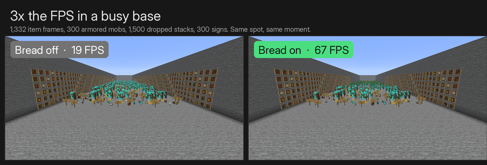
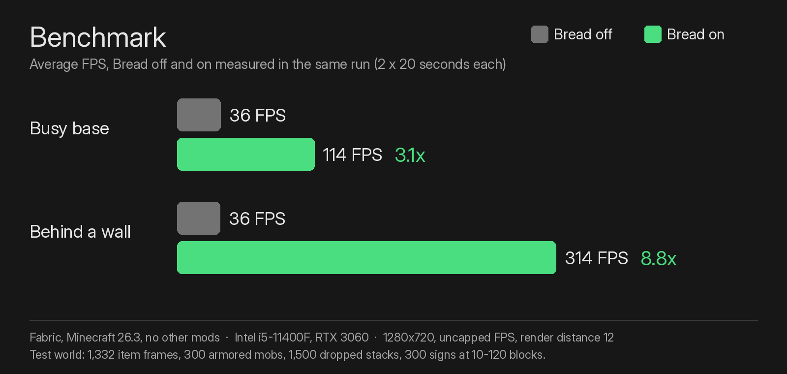
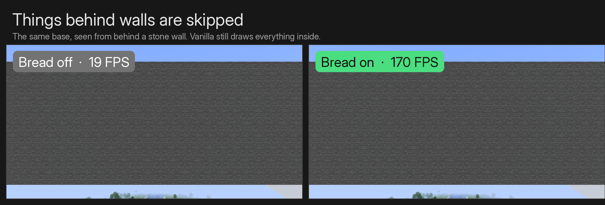
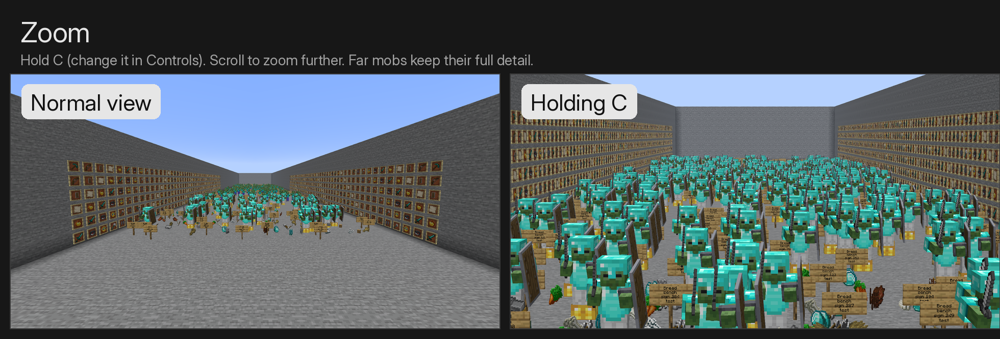
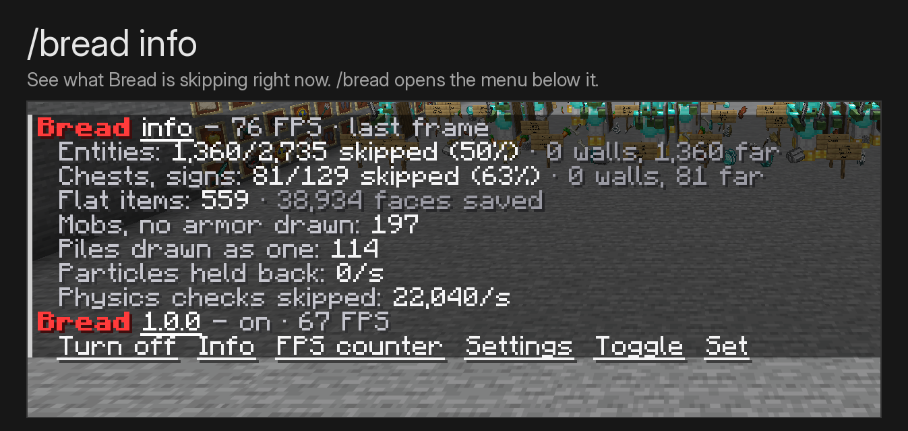

# Bread

More FPS where your game struggles, plus the small things vanilla should do.
Bread skips drawing what you cannot see or would not notice: mobs, chests and
item frames behind walls, details on far-away things, piles of dropped items.
In a busy base that is about **3x the FPS**. It also adds zoom, an FPS counter,
right-click harvesting, double doors and more. Every feature can be switched off.



Built on [Mycel](https://github.com/MyCelium-GG/MyCel-Lib) (`my.celium.org`), the shared
core for the MyCelium ecosystem.

| | |
|---|---|
| Mod id | `bread` |
| Minecraft | **26.3**, **26.2**, **26.1** (26.1-26.1.2) · Java **25** |
| Loaders | Fabric, Forge, NeoForge |
| Side | Client for performance, zoom and FPS counter (works on any server). The gameplay tweaks need Bread on the server, or singleplayer. |

## Performance

- **Hidden behind walls**: a background thread casts rays from the camera to
  every mob, chest, sign and item frame. Fully hidden ones are not drawn.
  Unknown counts as visible, so nothing flickers. Players, glowing mobs and
  beacon beams are never hidden. Turns itself off when Entity Culling is installed.
- **Far detail**: past a set distance, item frames, paintings and armor stands
  (64 blocks), dropped items (48), signs, banners and heads (32) are not drawn,
  mobs skip armor and held items (32), dropped stacks are one item instead of a
  pile (16), items in frames or on the ground are drawn flat (20), mob name tags
  stop at 32 blocks and the enchantment shimmer on items at 24. Zooming
  stretches all of these, so what you zoom in on keeps its detail.
- **Particles**: at most 4,000 of one kind instead of 16,384.
- **Dropped items**: your game skips their entity collision checks (the server
  still does them), and on the server items merge from 1.5 blocks, XP orbs from 2.
- **Background FPS**: 30 FPS while the window is not focused.



Bread works next to Sodium and Lithium: Sodium speeds up terrain, Lithium the
game logic, Bread the things standing in the world.



## Tweaks (server side)

- **Right-click harvest**: right-click a grown crop to harvest and replant it.
- **Double doors** open and close together.
- **Ladders**: click a ladder with a ladder to extend it down (up when you look up).
- **Bone meal** grows sugar cane and cactus.
- **Shovel** on a dirt path or farmland turns it back into dirt.
- **Villagers and wandering traders** can be put on a lead.
- **Feather Falling** boots do not trample farmland.
- **Snow golems** get their pumpkin back when you right-click them with one.

## Zoom, FPS counter, /bread

- **Zoom**: hold **C** (change it in Controls), scroll to zoom further.
- **FPS counter** in a corner of your choice, green, yellow or red.
- **/bread**: menu with buttons. `/bread info` shows what Bread skipped in the
  last frame, `/bread fps`, `/bread on|off`, `/bread config`,
  `/bread toggle <setting>`, `/bread set <setting> <number>`.





## Anonymous stats

Bread sends anonymous stats (which features are on, the number settings, your
FPS, how often features are used, and errors in its own code) to its FastStats
project through Mycel. It follows Mycel's choice exactly: the one-time screen
in your own game. Details: https://wiki.mycelium-gg.org/privacy#stats-bread

## Configuration (`config/bread.json`)

| Key | Default | Meaning |
|---|---|---|
| `enabled` | `true` | Master switch. |
| `tweaks.right_click_harvest` | `true` | Right-click grown crops to harvest and replant. |
| `tweaks.double_doors` | `true` | Double doors open together. |
| `tweaks.ladder_extend` | `true` | Click a ladder with a ladder to extend it. |
| `tweaks.bone_meal_cane_and_cactus` | `true` | Bone meal grows sugar cane and cactus. |
| `tweaks.shovel_path_to_dirt` | `true` | Shovel turns dirt path and farmland back into dirt. |
| `tweaks.leash_villagers` | `true` | Villagers and wandering traders on leads. |
| `tweaks.feather_falling_saves_crops` | `true` | Feather Falling boots do not trample farmland. |
| `tweaks.snow_golem_pumpkin` | `true` | Put a pumpkin back on a sheared snow golem. |
| `performance.hide_unseen` | `true` | Skip things fully behind walls. |
| `performance.decor_entity_distance` | `64` | Item frames, paintings, armor stands. 0 = vanilla. |
| `performance.dropped_item_distance` | `48` | Dropped items and XP orbs. 0 = vanilla. |
| `performance.sign_distance` | `32` | Signs, banners and heads. 0 = vanilla. |
| `performance.far_mob_detail_distance` | `32` | Mobs drop armor and held items past this. 0 = vanilla. |
| `performance.item_pile_distance` | `16` | Dropped stacks drawn as one item past this. 0 = vanilla. |
| `performance.flat_item_distance` | `20` | Items drawn without pixel edges past this. 0 = vanilla. |
| `performance.name_tag_distance` | `32` | Mob name tags past this are not drawn (players keep theirs). 0 = vanilla. |
| `performance.glint_distance` | `24` | No enchantment shimmer on items past this. 0 = vanilla. |
| `performance.max_particles` | `4000` | Most particles of one kind. 0 = vanilla (16384). |
| `performance.fast_dropped_items` | `true` | Client skips entity collision checks for items and orbs. |
| `performance.background_fps` | `30` | FPS limit while not focused. 0 = no limit. |
| `performance.item_merge_radius` | `1.5` | Server: item merge distance (vanilla 0.5). 0 = vanilla. |
| `performance.xp_merge_radius` | `2.0` | Server: XP orb merge distance (vanilla 0.5). 0 = vanilla. |
| `hud.fps_counter` | `false` | Show the FPS counter. |
| `hud.fps_counter_corner` | `top_left` | `top_left`, `top_right`, `bottom_left`, `bottom_right`. |
| `zoom.zoom` | `true` | Zoom while holding the key. |
| `zoom.zoom_level` | `4` | How many times closer the zoom starts. |
| `zoom.zoom_scroll` | `true` | Scroll to change the zoom. |
| `zoom.zoom_smooth` | `true` | Ease the zoom in and out. |

Change them in game with `/bread config` or `/bread set`, or reload the file
with `/mycel reload bread`.

## Building

JDK 25, then:

```sh
./gradlew build            # all loaders
./gradlew build -Pmc=26.1  # the 26.1 or 26.2 line
```
